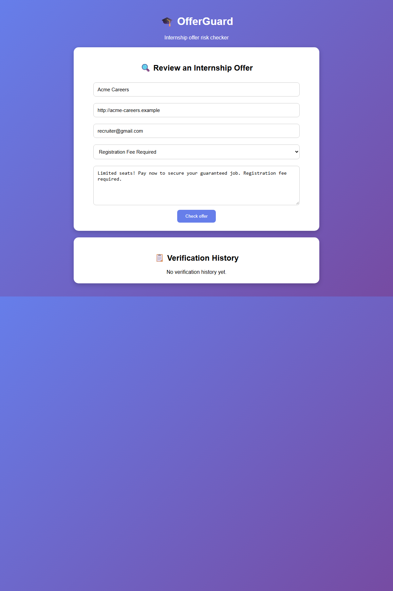

# OfferGuard

OfferGuard is a small frontend/backend internship offer risk checker. The browser provides the form and results, while a Python backend reviews common warning signs and saves every check to a CSV file.

## Run locally

1. Install Python 3 if it is not already installed.
2. Open a terminal in the `OfferGuard` folder and run `python server.py` (on Windows, `py -3 server.py` also works).
3. Open <http://127.0.0.1:8000> in a modern browser.
4. Enter the company name and offer message. Website and recruiter email are optional, but missing details can increase the score.
5. Select whether a registration fee is requested, then choose **Check offer**.

The backend creates `data/verifications.csv` the first time an offer is checked. The verification history is loaded from this CSV, so it remains available after restarting the server. No external service, account, or API key is required. The server listens only on this computer (`127.0.0.1`).

## Frontend and backend

- `index.html`, `style.css`, and `script.js` make up the browser frontend.
- `server.py` serves the frontend and provides `POST /api/verifications` to score and save a check and `GET /api/verifications` to load saved history.
- `data/verifications.csv` is created automatically and stores the offer details, score, risk level, and reasons for each check.
- CSV cells that could be interpreted as spreadsheet formulas are escaped before they are stored.

## Offer review protocol

OfferGuard applies a transparent set of warning checks:

| Signal | Score added |
| --- | ---: |
| Registration fee requested | 35 |
| Company website missing | 15 |
| Website uses HTTP instead of HTTPS | 10 |
| Recruiter email missing | 10 |
| Recruiter uses a common free email domain | 15 |
| Each suspicious phrase detected | 10, capped at 30 |

The final score is capped at 100. Scores below 30 are labeled low risk, 30–59 medium risk, and 60 or higher high risk. The score is a screening heuristic, not proof that an offer is genuine or fraudulent. Independently verify the employer and offer before sharing personal information or paying money.

## Example output



## Project files

- `index.html` — form and result/history areas
- `style.css` — page styling
- `script.js` — frontend form, API calls, and result/history display
- `server.py` — local Python HTTP server, scoring, API, and CSV storage
- `test_server.py` — backend scoring and CSV persistence tests
- `screenshots/offerguard-output.png` — example output screenshot

## Run backend tests

```powershell
python -m unittest
```
